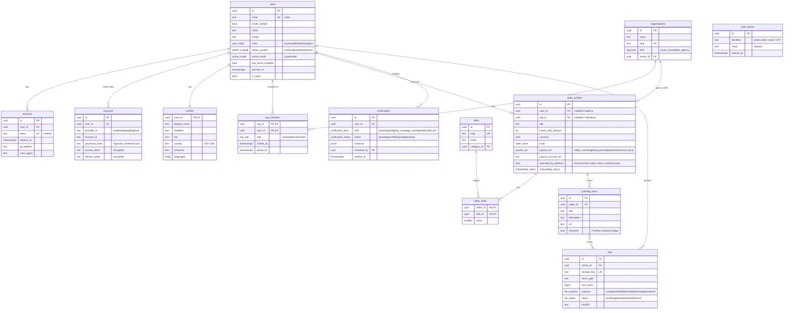
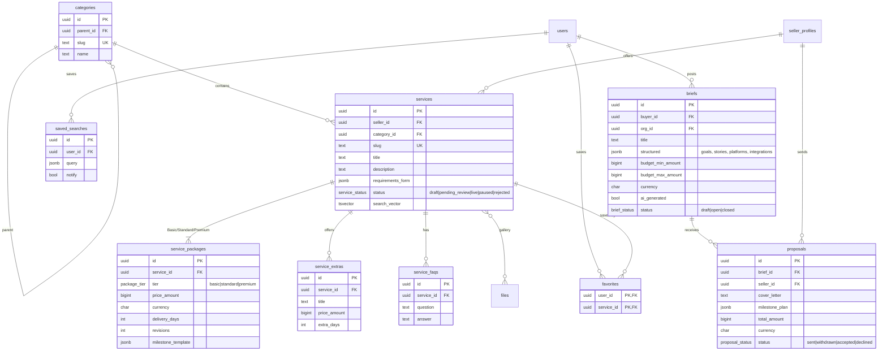
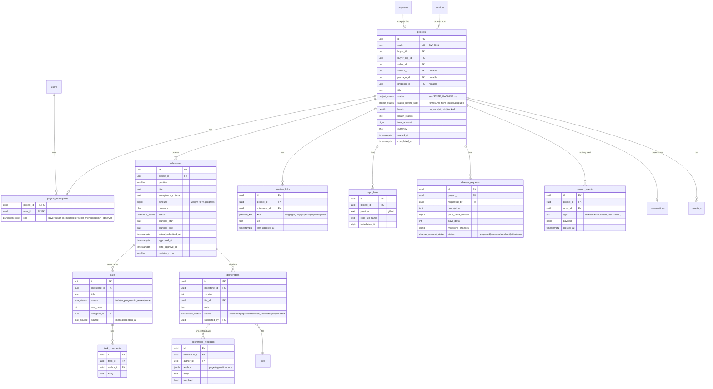
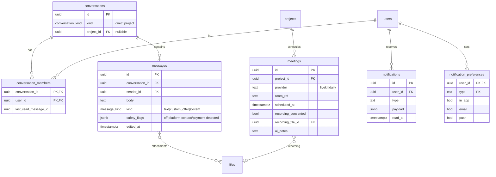
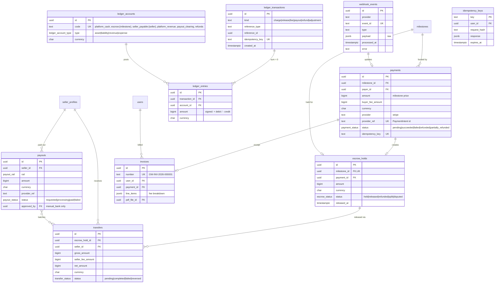
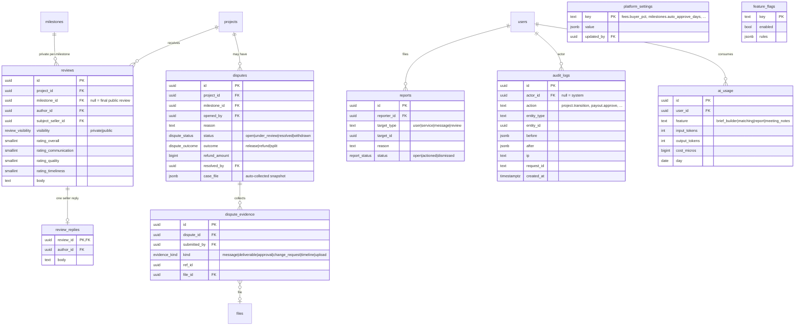

# Glasswork — Database ERD

PostgreSQL 17 · Drizzle ORM. Conventions (DECISIONS D-005..D-007):

- `id uuid` (UUIDv7) primary keys; `created_at` / `updated_at timestamptz`.
- Money: `*_amount bigint` (minor units) + `currency char(3)`.
- `is_seed boolean` on user-generated tables (dev seed only).
- Soft delete only where legally needed (`deleted_at`). Money and audit tables are append-only.

The ERD is split by domain so each diagram stays readable. Tables marked **(P0)** are created in Phase 0; the rest arrive in the phase that needs them, but the enums are defined up front.

---

## 1. Identity, auth & organisations

**(P0):** `users`, `sessions`, `accounts`, `auth_tokens`, `profiles`, `files`, `audit_logs`.

---

## 2. Catalogue & discovery

---

## 3. Projects, milestones & the Project Room

---

## 4. Communication

---

## 5. Money (all amounts bigint minor units)

---

## 6. Trust, admin & platform

---

## Key integrity rules (enforced in DB, not just in code)

- `ledger_entries`: deferred constraint trigger checks that `SUM(amount) = 0` per `transaction_id` and currency; UPDATE/DELETE revoked from the app role.
- `audit_logs`, `project_events`, `webhook_events`: append-only (the app role has no UPDATE/DELETE).
- `escrow_holds.milestone_id` unique: one hold per milestone funding. Re-funding after a change request creates a new milestone.
- `reviews`: unique `(project_id, author_id, milestone_id)`; insert allowed only when the project is `completed` (public review) or the milestone is `released` (private feedback). Checked in the service and backed by a trigger.
- All FK columns indexed; `services.search_vector` GIN; `pg_trgm` GIN on `services.title` and `profiles.display_name`.
