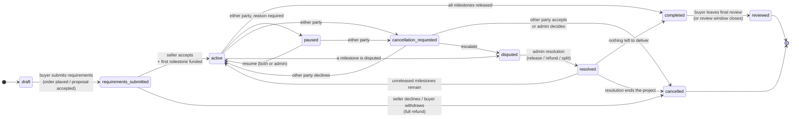
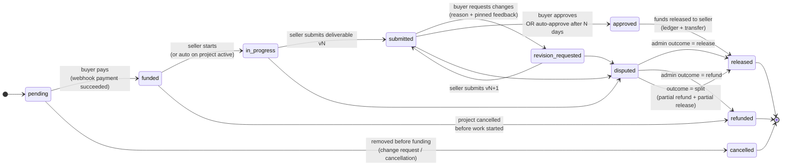

# Glasswork — Project & Milestone State Machines

Defined once in `packages/shared/src/state-machines/` as pure, typed transition tables, with exhaustive unit tests. The API enforces them server-side inside a DB transaction (`SELECT … FOR UPDATE` on the row). Every transition writes an `audit_logs` row and a `project_events` row (activity feed), and is broadcast to the project's Socket.io room.

The brief's single line (draft → … → reviewed) mixes two levels. DECISIONS D-025 splits it:

- the **project** machine covers the overall engagement;
- one **milestone** machine runs per milestone. A project has several milestones, each in its own state.

---

## 1. Project

| From → To                                  | Who                       | Guard                                                      | Side effects                                                                    |
| ------------------------------------------ | ------------------------- | ---------------------------------------------------------- | ------------------------------------------------------------------------------- |
| draft → requirements_submitted             | buyer                     | requirements form valid; ≥1 milestone                      | notify seller; start acceptance SLA timer                                       |
| requirements_submitted → active            | seller                    | milestone #1 is `funded`                                   | `started_at`; health = on_track                                                 |
| requirements_submitted → cancelled         | seller / buyer            | no milestone `in_progress`                                 | refund all funded holds (ledger)                                                |
| active → completed                         | system                    | every milestone is `released` (or `cancelled` with refund) | `completed_at`; open the review window (14 days)                                |
| completed → reviewed                       | buyer / system            | public review exists **or** the window expired             | update seller metrics                                                           |
| active ↔ paused                            | buyer/seller → both/admin | reason text                                                | freeze milestone auto-approve timers; save `status_before_side`                 |
| * → cancellation_requested                 | buyer / seller            | project not completed                                      | notify the other party; 3-day response timer                                    |
| cancellation_requested → cancelled         | other party / admin       | —                                                          | refund `funded` holds; work already `approved`/`released` stays paid            |
| active / cancellation_requested → disputed | buyer / seller            | at least one milestone is funded                           | freeze timers; admin auto-builds the case file                                  |
| disputed → resolved                        | admin (operations)        | outcome recorded with a reason                             | ledger: release / refund / split; affected milestones → `released` / `refunded` |
| resolved → active / completed / cancelled  | system                    | based on the remaining milestones                          | —                                                                               |

---

## 2. Milestone

| From → To                                               | Who                                         | Guard                                                                                      | Side effects                                                            |
| ------------------------------------------------------- | ------------------------------------------- | ------------------------------------------------------------------------------------------ | ----------------------------------------------------------------------- |
| pending → funded                                        | system (webhook)                            | payment `succeeded`; amount matches the DB price (never client-sent)                       | create `escrow_holds`; ledger charge                                    |
| funded → in_progress                                    | seller / system                             | project `active`                                                                           | notify buyer                                                            |
| in_progress → submitted                                 | seller                                      | ≥1 deliverable version uploaded and scanned clean                                          | `auto_approve_at = now + N days`; reminders at day 2 and day 4 (worker) |
| submitted → revision_requested                          | buyer                                       | reason required; revision count ≤ package limit (above the limit → offer a change request) | clear `auto_approve_at`; `revision_count++`                             |
| revision_requested → submitted                          | seller                                      | new deliverable version                                                                    | reset `auto_approve_at`                                                 |
| submitted → approved                                    | buyer / system (auto)                       | project not `paused`/`disputed`                                                            | `approved_at`; enqueue release job                                      |
| approved → released                                     | system (worker)                             | release job, idempotent per milestone                                                      | ledger: escrow → seller_payable + platform_revenue; create transfer     |
| pending → cancelled                                     | buyer + seller (via change request) / admin | not funded                                                                                 | —                                                                       |
| funded → refunded                                       | system / admin                              | project cancelled; milestone not started                                                   | refund via PaymentsProvider; ledger refund                              |
| in_progress / submitted / revision_requested → disputed | buyer / seller                              | funded                                                                                     | freeze timer; project → `disputed`                                      |
| disputed → released / refunded                          | admin (operations)                          | outcome + reason                                                                           | ledger entries; audit with before/after                                 |

---

## 3. Derived values (computed, never stored by the client)

- **Progress %** = Σ(weight of each milestone × milestone completion) / Σ weights. A milestone's weight is its `amount`; completion is `released`/`approved` = 1.0, `submitted` = 0.8, `revision_requested` = 0.6, `in_progress` = done tasks ÷ total tasks × 0.6, otherwise 0. _(These ratios are proposals; they'll be shown publicly in the UI, consistent with "transparency is the product".)_
- **Health:**
  - `blocked`: waiting on the buyer for more than 3 days (unfunded next milestone, or an unanswered question flagged as blocking), or project paused/disputed.
  - `at_risk`: planned due date passes in less than 20% of the milestone's duration while progress is under 70%, or the milestone is already overdue.
  - Otherwise `on_track`. The reason string is always stored with it.
- **Escrow vs released:** sums from `escrow_holds` by status; cross-checked against the ledger balances.

## 4. Timers (BullMQ, worker)

- `milestone.auto_approve` at `auto_approve_at` (default 5 days, D-022); re-checks state before acting.
- `milestone.reminder` at day 2 and day 4 after submission.
- `project.cancellation_timeout`: 3 days.
- `project.review_window_close`: 14 days after `completed`.
  All jobs are idempotent (job id = `${type}:${entityId}:${version}`) and become no-ops if the state changed in the meantime.
